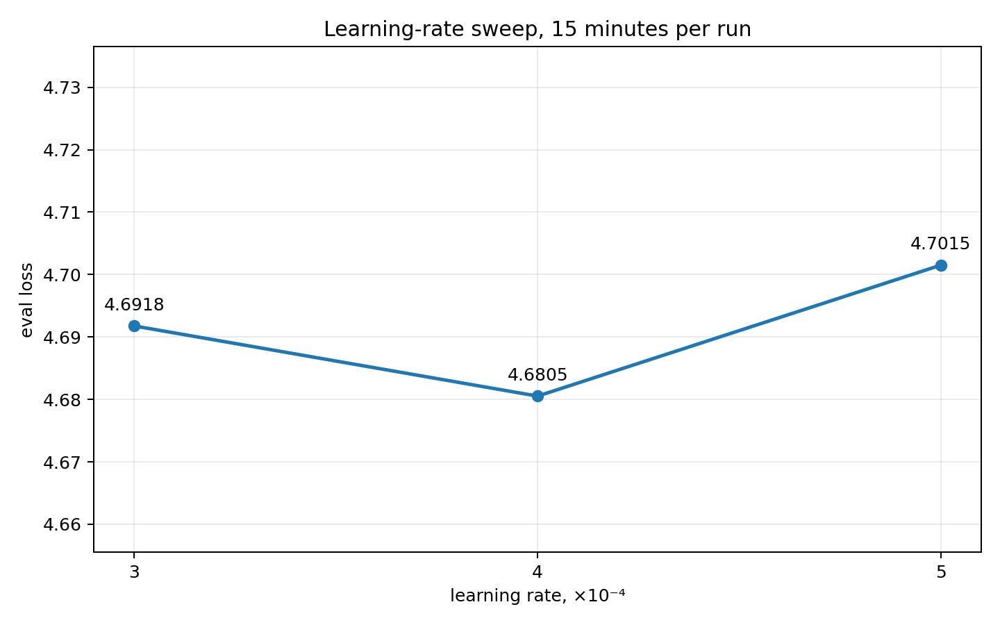
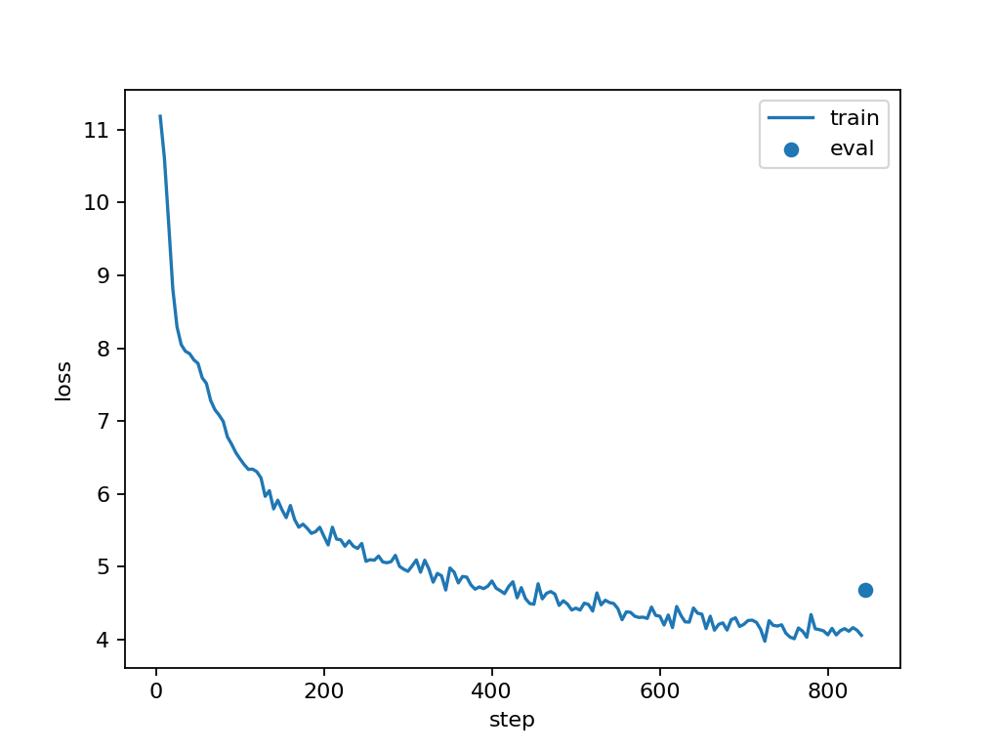

# Мини-претрейн Qwen3 1B на русской Википедии

Я обучил модель с нуля на одной A100 80 GB. Каждый полный запуск длился ровно 15 минут. Лучший результат получился при `learning_rate=4e-4` и `constant_with_warmup`: финальный `eval_loss` — **4.6805**, perplexity — **107.83**. Архитектуру из задания я не менял.

## Данные и модель

- датасет: `wikimedia/wikipedia`, конфигурация `20231101.ru`;
- всего 1 945 063 примера;
- первые 5 000 примеров оставлены для validation, остальные 1 940 063 — для train;
- токенизатор: `ai-forever/rugpt3small_based_on_gpt2`;
- фиксированная длина примера: 512 токенов;
- токенизированный датасет сохранён в 32 parquet-файла;
- модель: Qwen3, 960 881 664 параметра, инициализация с нуля;
- attention: `flash_attention_2`.

## Среда

| Компонент | Значение |
|---|---|
| GPU | NVIDIA A100 80 GB PCIe |
| Драйвер | 470.182.03 |
| CUDA в контейнере | 11.8 |
| PyTorch | 2.6.0+cu118 |
| Transformers | 4.52.0 |
| Datasets | 3.6.0 |
| Flash Attention | 2.7.3 |
| Тип вычислений | bf16 + tf32 |

## Как выбирал параметры

### Batch size

Сначала я проверил, какой batch помещается на этой машине. Пробы для batch 8, 32 и 64 состояли из одного train-step, поэтому их время нельзя напрямую сравнивать со скоростью полного `Trainer`. Для оценки памяти этого достаточно.

| Batch size | Время шага | Пиковая память | Результат |
|---:|---:|---:|---|
| 8 | 1.48 с | 10.08 GiB | Работает с большим запасом памяти |
| 32 | 1.96 с | 34.91 GiB | Работает стабильно |
| 64 | 2.61 с | 68.01 GiB | Один шаг проходит, длительный запуск падает с OOM |
| 48 | около 1.07 с в `Trainer` | около 63 GiB во время train | Стабильно работает все 15 минут |

В итоге я выбрал `per_device_train_batch_size=48` и `gradient_accumulation_steps=1`. Накопление градиента не требуется: рабочий batch помещается сразу.

### Оптимизатор, dtype и compile

`adamw_torch` и `adamw_torch_fused` на batch 32 показали одинаковые 1.96 с на пробном шаге и одинаковый пик памяти. В финальной конфигурации я оставил fused-вариант и использовал `beta2=0.95`.

На A100 обучение стабильно работает в bf16 с включённым tf32. `torch_compile` я тоже проверил, но Triton завершился ошибкой `device kernel image is invalid` при загрузке CUDA-ядра. Поэтому в рабочих запусках `torch_compile=False`.

### Исправление padding и использование 15 минут

В первой версии `labels` полностью копировали `input_ids`. Из-за этого padding, который совпадает с EOS-токеном, тоже попадал в loss. На выборке из 10 000 примеров padding занимал около 13.3% позиций. В финальном варианте collator заменяет соответствующие значения `labels` на `-100`, поэтому метрика считается только по настоящим токенам.

Также я убрал промежуточные evaluation и checkpoint из 15-минутного интервала. Финальная оценка на всех 5 000 validation-примерах запускается сразу после обучения. За то же время число train-step выросло примерно с 605 до 844.

Первые и финальные запуски используют разные правила подсчёта loss, поэтому я не смешиваю их в одной сравнительной таблице.

## Первые эксперименты

Эта серия помогла выбрать scheduler и рабочий диапазон learning rate. Здесь padding ещё участвовал в loss, а evaluation выполнялся каждые 100 шагов.

| Запуск | Learning rate | Scheduler | Warmup | Шагов | Средний train loss | Eval loss |
|---|---:|---|---:|---:|---:|---:|
| Baseline | 5e-5 | linear | 200 | 609 | 8.6607 | 7.3389 |
| Высокий LR | 2e-4 | constant with warmup | 50 | 605 | 7.3176 | 5.9303 |
| Cosine | 2e-4 | cosine | 50 | 605 | 7.3582 | 6.1923 |

`2e-4` оказался намного лучше `5e-5`. При одинаковом learning rate constant scheduler выиграл у cosine: в таком коротком претрейне раннее уменьшение learning rate мешает модели.

## Финальный sweep learning rate

Во всех трёх финальных запусках использовались одинаковые данные, модель, batch 48, `gradient_accumulation_steps=1`, fused AdamW с `beta2=0.95`, bf16/tf32, warmup 50 шагов и `constant_with_warmup`. Из обучающих параметров отличался только learning rate. В первом запуске loss логировался каждый шаг, в двух остальных — раз в пять шагов; на обновления модели это не влияет. Padding был исключён из loss, а evaluation выполнялся после 15 минут обучения.

| Learning rate | Шагов | Средний train loss | Финальный eval loss | Perplexity |
|---:|---:|---:|---:|---:|
| 3e-4 | 846 | 5.1584 | 4.6918 | 109.05 |
| **4e-4** | **844** | **5.0970** | **4.6805** | **107.83** |
| 5e-4 | 843 | 5.1198 | 4.7015 | 110.11 |

Perplexity рассчитана как `exp(eval_loss)`. Средний train loss включает первые шаги с почти случайной моделью, поэтому он заметно выше значений в конце кривой.

Для каждой конфигурации сделан один полный запуск с одинаковым seed. Это практический sweep без оценки разброса по разным seed, поэтому разницу между `3e-4` и `4e-4` нельзя считать большой. `5e-4` уже немного ухудшил validation loss, поэтому поднимать learning rate дальше я не стал.



*Рис. 1. Validation loss в финальном sweep. Вертикальная шкала увеличена, чтобы была видна небольшая разница между тремя learning rate.*

Кривая loss лучшего запуска:



*Рис. 2. Train loss по шагам и итоговый validation loss для запуска с `learning_rate=4e-4`.*

Я дополнительно попробовал собирать короткие статьи в плотные блоки по 512 токенов. Это повысило throughput, но два запуска получили NaN в градиентах: с `4e-4` примерно на 260-м шаге, с `3e-4` — примерно на 644-м. Нестабильный вариант в финальное решение не включён.

## Генерации лучшей модели

Ниже приведены результаты из сохранённого `generations.json` без исправления ошибок модели.

Промпт: `Искусственный интеллект — это`

```text
Искусственный интеллект — это слово.

Участие
  — американский художественный фильм по мотивам одноимённого романа, снятый в 1953 году.
  — американский боевик режиссёра.
  — американский художественный фильм по заказу Социал-шоу «Круппег».
  — американский фильм о приключениях (1956) кино.
  — британский боевик в жанре драматического кино.
  —
```

Промпт: `Москва является столицей`

```text
Москва является столицей на юге, а затем в 17—1829 годы). В том числе и 1818—1818 годов.

В 1873 году, после упразднения войсковой комиссии, деревня входила в состав Больше-Троицкой волости.

Население

Национальный состав
Согласно результатам переписи 2002 года, в национальной структуре населения русские составляли 100 %

Примечания

Ссылки
```

Промпт: `В начале научного эксперимента`

```text
В начале научного эксперимента и её отца, дочери — Р. В. Сталина, сына — Иван Михайлович.

Наследие
Орден преподобного князя Михаила Первозванного от 2 марта 1918 года.
Орден Дружбы (25 апреля 1904 года)
Орден преподобного Сергия Радонежского II ст.

Примечания

Литература
```

После 15 минут модель уже воспроизводит локальную структуру русского текста и типичные шаблоны Википедии: заголовки, даты, списки и биографические конструкции. При этом смысл и факты остаются ненадёжными, встречаются ошибки согласования и ложные даты. По оценке доли padding на выборке модель увидела примерно 18 млн непустых токенов. Для модели почти на миллиард параметров это очень короткий претрейн, поэтому такой результат ожидаем.

## Выводы

1. Стабильный batch для этой машины — 48. Batch 64 падает с OOM при длительном обучении.
2. Для 15-минутного претрейна constant scheduler оказался лучше cosine.
3. В финальном sweep лучший результат дал `learning_rate=4e-4`, но `3e-4` отстал совсем немного.
4. Исключение padding из loss делает обучение и итоговую метрику корректнее.
5. Отказ от промежуточных evaluation и checkpoint позволил выполнить примерно на 40% больше train-step за те же 15 минут.
6. `torch_compile` несовместим с текущим драйвером, но Flash Attention, bf16 и tf32 работают стабильно.
7. Модель уже имитирует форму русскоязычной Википедии, но короткого претрейна недостаточно для надёжных фактов и длинных смысловых связей.

## Как запустить

Сборка образа:

```bash
docker build -t llm-hw1 .
```

Подготовка датасета:

```bash
docker run --rm --gpus all --shm-size=16g \
  -v "$PWD:/app" -w /app \
  -e PREPARE_DATASET=1 \
  llm-hw1 python your_solution.py
```

Лучший режим уже стоит в коде по умолчанию:

```bash
docker run --rm --gpus all --shm-size=16g \
  -v "$PWD:/app" -w /app \
  llm-hw1 python your_solution.py
```

Продолжительность задаёт callback на 900 секунд. `num_train_epochs=1` — только верхняя граница для `Trainer`: фактически лучший запуск прошёл около 2.1% эпохи и остановился по времени.

Параметры можно менять через `BATCH_SIZE`, `EVAL_BATCH_SIZE`, `GRAD_ACCUM`, `LEARNING_RATE`, `LR_SCHEDULER`, `WARMUP_STEPS`, `ADAM_BETA2`, `WEIGHT_DECAY`, `MAX_STEPS`, `OPTIM`, `TORCH_COMPILE` и `RUN_NAME`.

Минимальная проверка маскирования padding:

```bash
docker run --rm \
  -v "$PWD:/app" -w /app \
  llm-hw1 python test_solution.py
```

В папке `results` лежат графики, финальные метрики, конфиги, генерации и `trainer_state.json` для каждого стабильного запуска.
